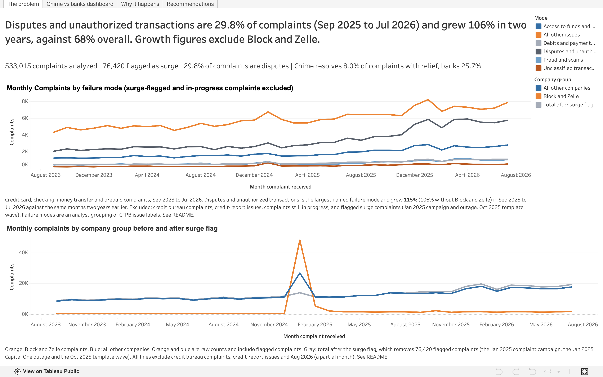
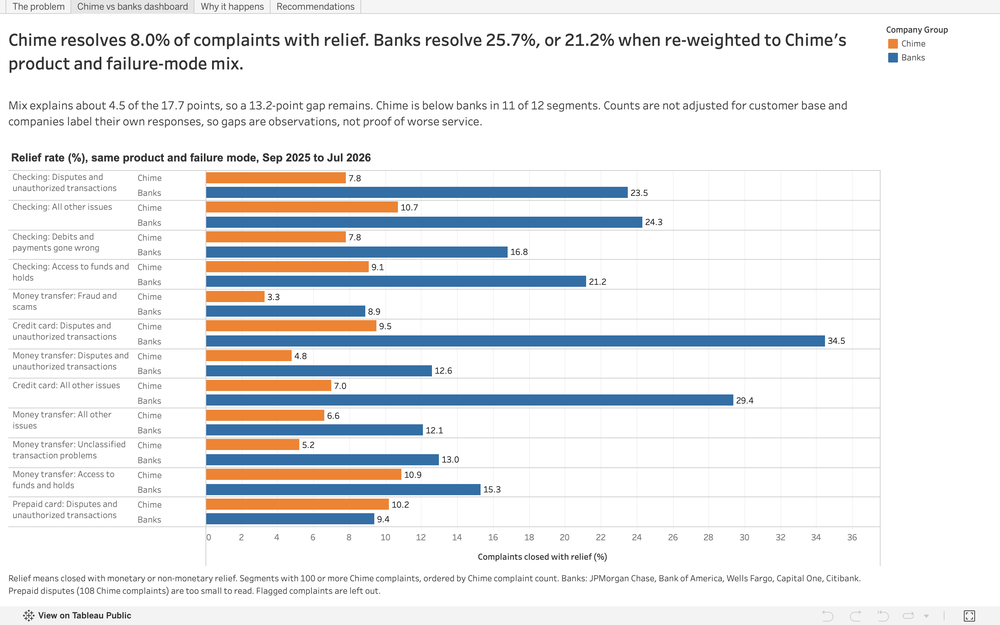
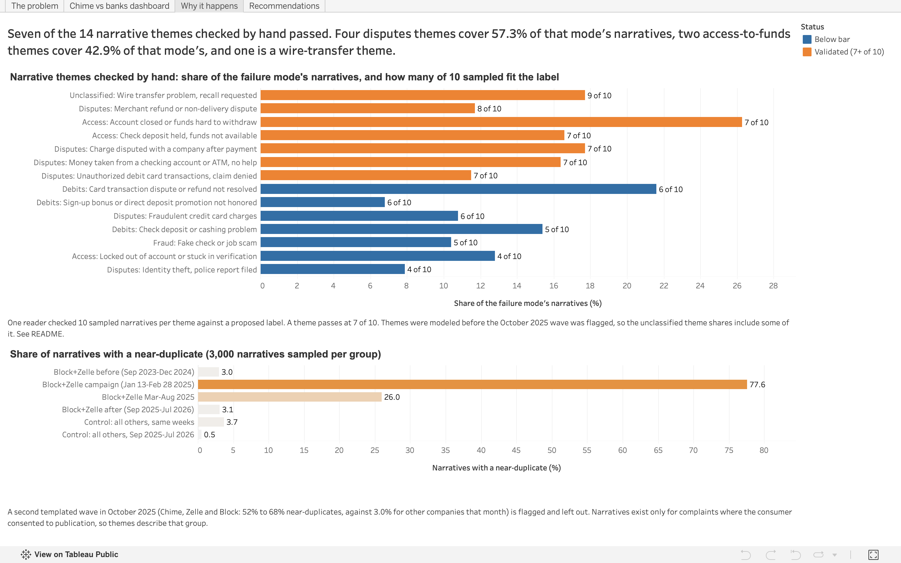
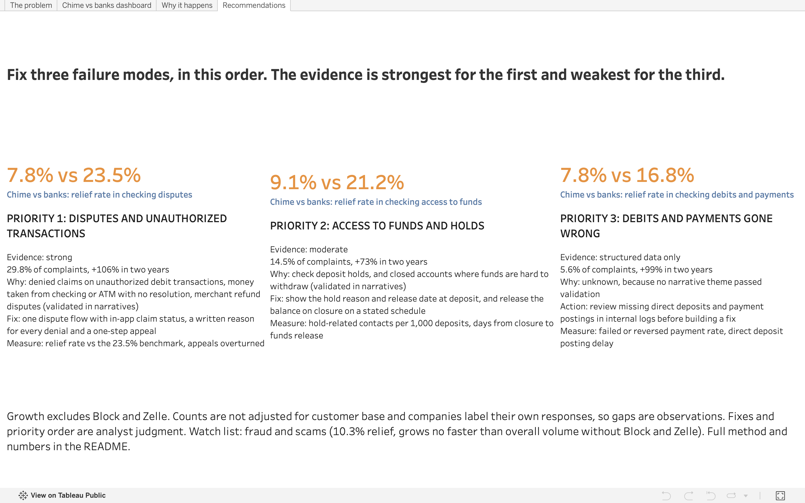

# CFPB Complaints Intelligence

**Which complaint failures should a fintech or neobank fix first?** Real CFPB complaint data, analyzed with SQL (DuckDB), Python text analysis and four Tableau dashboards, ending in a prioritized recommendation.

**Live dashboards:** [View on Tableau Public](https://public.tableau.com/views/CFPBComplaintsIntelligence/Theproblem) | **Recommendation memo:** [docs/recommendation_memo.md](docs/recommendation_memo.md)

## Recommendations

The three priorities have different strengths of evidence, and the fixes are analyst judgment tied to the narrative themes that passed validation.

| Priority | Failure mode | Share of complaints | Growth without Block and Zelle | Evidence |
| --- | --- | --- | --- | --- |
| 1 | Disputes and unauthorized transactions | 29.8% | +106% | Strong: structured data and four validated narrative themes |
| 2 | Access to funds and holds | 14.5% | +73% | Moderate: structured data and two validated themes (42.9% of the mode's narratives) |
| 3 | Debits and payments gone wrong | 5.6% | +99% | Structured data only: no narrative theme passed validation |

Overall complaint volume grew 67.6% over the same period without Block and Zelle (76.5% with them).

**1. Disputes and unauthorized transactions.** Chime's checking disputes close with relief 7.8% of the time against 23.5% at banks, and disputes are 45.2% of Chime's checking complaints against 27.0% at banks.
- Validated root causes: unauthorized debit card transactions where the claim is denied (11.5% of the mode's narratives) and money taken from a checking account or ATM with no resolution (16.4%), plus merchant refund or non-delivery disputes (11.7%) and charges disputed with a company after payment (17.7%).
- Fix: one dispute flow for card and account disputes with in-app claim status, a specific written reason for every denial, and a one-step appeal with evidence upload.
- Measure: dispute relief rate against the 23.5% bank benchmark in checking, share of denied claims appealed and overturned, disputes closed within regulatory timelines, complaints per 10,000 active accounts.

**2. Access to funds and holds.** Chime's checking relief is 9.1% against 21.2% at banks.
- Validated root causes: check deposit holds (16.6% of the mode's narratives) and closed accounts or funds that are hard to withdraw (26.3%). The lockout and verification theme failed validation (4 of 10), and about half of its misfits were unauthorized activity or account security complaints.
- Fix: show the hold reason and release date at deposit, release part of the deposit where possible, and on account closure release the remaining balance on a stated schedule with notice.
- Measure: hold-related contacts per 1,000 deposits, days from closure to funds release, relief rate against the 21.2% bank benchmark.

**3. Debits and payments gone wrong.** Chime's checking relief is 7.8% against 16.8% at banks.
- No narrative theme passed validation (5 or 6 of 10), so the narratives cannot name a root cause.
- Action: a root-cause review of missing direct deposits and payment postings using the company's own logs before building a fix. Complaint data only sizes the problem.
- Measure: failed or reversed payment rate and direct deposit posting delay.

**Watch list.** Fraud and scams has the worst outcomes at scale (10.3% relief) but grows no faster than overall volume without Block and Zelle (+67%), and its fake-check theme failed validation. Unclassified transaction problems (2.8% of complaints, +82% without Block and Zelle, after an October 2025 template wave was flagged) contain a validated wire-transfer theme (17.7% of the mode's narratives in the pre-flag model, 9 of 10).

## Interactive dashboard

[View the four dashboards on Tableau Public](https://public.tableau.com/views/CFPBComplaintsIntelligence/Theproblem). Built from five aggregated CSVs (no raw complaint rows).

## Key findings from the structured data

Growth compares Sep 2025 to Jul 2026 with Sep 2023 to Jul 2024, two years apart, so the Jan 2025 anomalies sit in neither window. Flagged complaints (see the surge section) are left out. Complaint counts and shares are for Sep 2025 to Jul 2026.

| Failure mode | Complaints | Share | Growth | Growth without Block and Zelle | Relief rate |
| --- | --- | --- | --- | --- | --- |
| Disputes and unauthorized transactions | 56,175 | 29.8% | +115% | +106% | 23.3% |
| Access to funds and holds | 27,430 | 14.5% | +86% | +73% | 17.3% |
| Debits and payments gone wrong | 10,586 | 5.6% | +105% | +99% | 14.5% |
| Fraud and scams | 10,320 | 5.5% | +98% | +67% | 10.3% |
| Unclassified transaction problems | 5,287 | 2.8% | +114% | +82% | 13.1% |
| All other issues | 78,751 | 41.8% | +48% | +44% | 22.4% |

1. **One failure, four product labels.** Disputes and unauthorized transactions appear under credit card (26,721 complaints), checking (21,496), money transfer (5,938) and prepaid (2,020). Checking alone grew 108%, and the mode without credit cards has 29,454 complaints, up 122%.
2. **Chime resolves far fewer complaints than banks, and mix explains about a quarter of the gap.** Relief rate, Sep 2025 to Jul 2026: Chime 8.0% (9,969 complaints), banks 25.7%. Re-weighting banks to Chime's product and failure-mode mix gives 21.2%, so mix explains about 4.5 of the 17.7 points and a 13.2-point gap remains.
3. **Chime's complaints concentrate in disputes.** Within checking, disputes and unauthorized transactions are 45.2% of Chime's complaints and 27.0% of banks'. Debits and payments gone wrong are 15.3% vs 13.4%, and access to funds is 14.8% vs 24.4%.
4. **The gap holds inside the same product and failure mode.** Chime is below banks in 11 of 12 cells with 100 or more Chime complaints.

| Relief rate, same product and mode | Chime complaints | Chime | Banks |
| --- | --- | --- | --- |
| Checking: disputes and unauthorized transactions | 3,298 | 7.8% | 23.5% |
| Checking: all other issues | 1,795 | 10.7% | 24.3% |
| Checking: debits and payments gone wrong | 1,119 | 7.8% | 16.8% |
| Checking: access to funds and holds | 1,078 | 9.1% | 21.2% |
| Money transfer: fraud and scams | 800 | 3.3% | 8.9% |
| Credit card: disputes and unauthorized transactions | 581 | 9.5% | 34.5% |
| Money transfer: disputes and unauthorized transactions | 419 | 4.8% | 12.6% |
| Credit card: all other issues | 287 | 7.0% | 29.4% |
| Money transfer: all other issues | 136 | 6.6% | 12.1% |
| Money transfer: unclassified | 135 | 5.2% | 13.0% |
| Money transfer: access to funds and holds | 129 | 10.9% | 15.3% |
| Prepaid card: disputes and unauthorized transactions | 108 | 10.2% | 9.4% |

Prepaid disputes are the only cell without a gap, and the sample is small. PayPal's relief rate (38.5%) is at failure-mode level and is not adjusted for product.

5. **Block and Zelle show near-zero relief both before and after the 2025 complaint campaign.** Block's relief rate was 0.6% before the campaign, 0.0% during it and 0.1% after, and Early Warning Services (Zelle) was 0.0% in all three periods. This is a standing pattern in how those companies' responses are recorded, not a campaign effect, so Block is shown separately in the benchmark and left out of conclusions about peer performance.
6. **Chime's complaint volume roughly doubled and the rise is treated as real.** Kept complaints went from about 550 a month in Jun 2025 to about 1,000 a month in Jun and Jul 2026, and monthly disputes rose from 225 in Sep 2025 to 363 in Oct 2025 and stayed between 326 and 456. Template letters explain 21 of 5,423 Chime complaints from Oct 2025 to Mar 2026 (under 0.5%). The cause of the increase was not investigated.

## What the narratives show

**The complaint campaigns are visible in the text.** The test samples 3,000 narratives per group, measures near-duplicates (cosine similarity of 0.8 or higher within the group), shared 10-word openings and exact duplicates. Flagged complaints are left out of the two groups from Sep 2025.

| Group | Near-duplicate | Same opening | Exact duplicate |
| --- | --- | --- | --- |
| Block and Zelle, Sep 2023 to Dec 2024 | 3.0% | 2.5% | 0.4% |
| Block and Zelle, Jan 13 to Feb 28, 2025 | 77.6% | 83.1% | 56.1% |
| Block and Zelle, Mar to Aug 2025 | 26.0% | 27.2% | 16.1% |
| Block and Zelle, Sep 2025 to Jul 2026 | 3.1% | 5.5% | 1.2% |
| Other companies, same weeks as the campaign | 3.7% | 3.7% | 0.8% |
| Other companies, Sep 2025 to Jul 2026 | 0.5% | 1.6% | 0.0% |

In the first run of the test, two openings accounted for 71% of the sampled campaign-weeks narratives. After the campaign, the three most common openings cover 67 of 3,000 sampled narratives (2.2%). The test shows how the complaints were written, not whether each filer had a real problem.

**A second templated wave in October 2025.** Money transfer complaints filed as "Other transaction problem" jumped to 1,890 in October 2025 against about 270 to 520 in neighboring months, and Chime (555), Zelle (808) and Block (148) accounted for 80% of them. The narrative test, on the same issue in the same month:

| Group | Narratives available | Sampled | Near-duplicate | Same opening |
| --- | --- | --- | --- | --- |
| Chime, Oct 2025 | 364 | 100 | 62.0% | 76.0% |
| Zelle (Early Warning Services), Oct 2025 | 547 | 100 | 68.0% | 73.0% |
| Block, Oct 2025 | 95 | 95 | 51.6% | 46.3% |
| Chime, other months Jun 2025 to Jan 2026 | 67 | 67 | 11.9% | 9.0% |
| All other companies, Oct 2025 | 218 | 100 | 3.0% | 0.0% |

The same opening letter, "I am writing to formally express my concerns regarding", appears with the company name swapped in 64 of 100 sampled Chime narratives and 64 of 100 sampled Zelle narratives. Relief in the wave was 0.5% for Chime and 0.0% for Zelle and Block. The cause was not found, and no source documents this wave. These 1,511 complaints are flagged and left out of growth and rankings.

**Theme validation.** Themes come from a topic model per failure mode on complaints from Sep 2023 to Nov 2025, run before the October 2025 wave was flagged. For 14 of 31 themes, one reader checked 10 sampled narratives each against a proposed label (140 in all). 88 fit (63%), and seven themes reached 7 of 10.

| Theme | Share of mode narratives | Relief | Fit |
| --- | --- | --- | --- |
| Disputes: charge disputed with a company after payment | 17.7% | 35.8% | 7 of 10 |
| Disputes: money taken from checking or ATM, no help | 16.4% | 20.7% | 7 of 10 |
| Disputes: merchant refund or non-delivery | 11.7% | 32.7% | 8 of 10 |
| Disputes: unauthorized debit card transactions, claim denied | 11.5% | 23.6% | 7 of 10 |
| Access: closed account or funds hard to withdraw | 26.3% | 18.8% | 7 of 10 |
| Access: check deposit held | 16.6% | 21.8% | 7 of 10 |
| Unclassified: wire transfer problem | 17.7% | 14.3% | 9 of 10 |

Seven themes fell below the bar: fraudulent credit card charges (6), card dispute or refund not resolved (6), sign-up bonus or direct deposit promotion (6), check deposit or cashing problem (5), fake check or job scam (5), identity theft (4) and locked out or stuck in verification (4). Their misfit narratives showed that these labels mixed several complaint types.

**Not separable by this method.** Formal-letter text with no specifics ("despite", "resolution", "regarding") makes up 14.5% to 18.8% of several modes, and generic contact-failure clusters make up 9.6% to 42.6%. Their shares are reported, with no root cause claimed.

**Observation, not validated at scale.** The top terms of clusters in the debits, access and unclassified modes describe card disputes, claims and unauthorized transactions, so the disputes problem is probably larger than the 29.8% the CFPB's issue labels show. The one such cluster that was checked fit 6 of 10.

## The scenario

You are a product analyst at a hypothetical digital bank or payments app. Leadership asks: which complaint failures should we fix first? You use public complaints about peer companies as market evidence.

## Data and scope

**Sources.** CFPB Consumer Complaint Database (bulk CSV) for structured fields, and the CFPB Narratives Archive for complaint narratives. Complaint IDs match between the two.

**Window.** Complaints received Sept 1, 2023 to Aug 14, 2026. The window starts after the CFPB's Aug 24, 2023 complaint-form update, so one product and issue taxonomy applies throughout. Aug 14, 2026 is the date the CFPB stopped publishing narratives. August 2026 is a partial month and is left out of trend and growth analysis.

**Products in scope.** Credit card; Checking or savings account; Money transfer, virtual currency, or money service; Prepaid card. Credit reporting, debt collection, mortgage, student loan, vehicle loan and payday products are excluded because they are not neobank products.

| Step | Complaints |
| --- | --- |
| Complaints in window, four products | 605,225 |
| Credit bureau complaints (Equifax, Experian, TransUnion) | 52,511 |
| Credit-report issues under in-scope products | 62,834 |
| Excluded in total (the two overlap) | 72,210 |
| **Analysis set** | **533,015** |
| Of which flagged as surge (see below) | 76,420 |

Excluded and surge rows are flagged in the data, not deleted.

**Peer groups** (complaints before exclusions).

| Group | Companies | Complaints |
| --- | --- | --- |
| Fintech | Block (Cash App), PayPal, Chime, SoFi, Robinhood, Coinbase, Wise, Remitly, MoneyLion, Dave | 117,229 |
| Bank benchmark | JPMorgan Chase, Bank of America, Wells Fargo, Capital One, Citibank | 196,342 |

Varo does not appear in the data. Chime appears under two entity names, both mapped to Fintech. Block accounts for 61,656 complaints, 52.6% of the fintech group.

## Surge flags

The scoped data has 74,547 complaints in January 2025, against 11,584 in December 2024. Block (31,221) and Early Warning Services, which operates Zelle (16,722), account for most of the increase. Before that they averaged about 250 and 30 to 110 complaints a month.

- **Complaint campaign, early 2025.** Consumer Reports reported that Zelle and Cash App complaints rose nearly 15-fold in early 2025 after social media influencers told followers to file complaints, with more than 61,000 filed in the first eight months of the year. The companies told Consumer Reports that most came from the influencers' content. The narrative test above supports this. The CFPB issued an order against Block on Jan 16, 2025: a $55 million civil penalty plus $75 million to $120 million in consumer redress, which the CFPB's press release headlines as $175 million.
- **Capital One outage.** A mid-January 2025 outage at Capital One, caused by its vendor FIS Global, explains part of the remaining excess. The cause of the Navy Federal spike was not found.
- **October 2025 template wave.** Described in the narratives section. No source documents it.
- **Handling.** Three groups of complaints are flagged and left out of growth and rankings: Block and Zelle complaints from Jan 13 to Aug 31, 2025; the Jan 13 to 31 complaints of any other company whose volume more than tripled (Capital One and Navy Federal); and Chime, Block and Zelle complaints filed as money transfer, other transaction problem in October 2025.
- **Block after the campaign.** Kept Block complaints ran at about 1,000 to 1,400 a month from Sep to Dec 2025, roughly 4 to 5 times its old level. Its narratives from Sep 2025 are mostly not templated (3.1% near-duplicates against 0.5% for other companies), but every ranking is also run without Block and Zelle.

Sources: [Consumer Reports](https://www.consumerreports.org/money/scams-fraud/cfpb-not-giving-money-to-people-scammed-on-zelle-cash-app-a9372236265/), [CFPB order against Block](https://www.consumerfinance.gov/enforcement/actions/block-inc/), [Fortune on the Capital One outage](https://fortune.com/article/capital-one-service-outage-january-2025-update).

## Method

- **Relief** means closed with monetary or non-monetary relief. **Poor outcome** means no relief or an untimely response. Complaints still in progress are excluded from outcome rates.
- **Failure modes** group CFPB issue and sub-issue labels by what went wrong. The grouping is analyst judgment, and the full definition is the CASE statement in 12_failure_modes.sql.
- **Fixability ratings** (10_fixability.sql) are analyst judgment, not data.
- **Sensitivity.** Issue-level priority scores were tested across 12 scenarios (six weight sets, with and without Block and Zelle). Only two issues stayed in the top five in at least 10 of the 12 (money transfer fraud or scam, and checking charged by a lender or other company), so the final analysis groups by failure mode instead of ranking issue labels.
- **Mix-adjusted benchmark.** Chime's relief rate is compared with the banks' rate in the same product and failure mode (14_benchmark_product.sql), then banks are re-weighted to Chime's product and mode mix. The mode-only version in 13_benchmark.sql does not adjust for product and is kept for reference.
- **Campaign test** (campaign_test.py). Narratives are normalized, then near-duplicates are measured within each group in equal-size random samples.
- **Themes** (themes.py). TF-IDF and NMF per failure mode, with company names and common narrative verbs removed. Narratives under 30 words, template openings from Block and Zelle, and exact duplicates are dropped first. Each mode is capped at 20,000 sampled narratives, with a fixed random seed.
- **Validation** (validate.py). One reader judged whether the main complaint in each sampled narrative matched the theme's proposed label. A theme passes at 7 of 10.

## Narratives

The bulk file has no narrative column, so narratives come from the Narratives Archive. Of 318,648 narratives extracted for the four products, 297,905 match the analysis set, which is 55.9% of it. Coverage is stable at 55.5% to 62.8% of in-scope complaints from Sep 2023 to Nov 2025, except January 2025 (79.3%, the campaign month) and February 2025 (65.8%). It falls to 43.7% in December 2025, 24.0% to 49.0% from Jan to Jul 2026, and 0% in August 2026. Theme analysis uses Sep 2023 to Nov 2025 only. The cause of the drop was not investigated.

## CFPB complaint-form changes

The CFPB periodically changes the products and issues on its complaint form, and the database keeps the labels consumers saw when they filed.

| Change | Effective | Impact on this project |
| --- | --- | --- |
| Form update: product and issue options revised | Aug 24, 2023 | Window starts Sept 1, 2023 to avoid it |
| "Credit card or prepaid card" split into "Credit card" and "Prepaid card" | Aug 24, 2023 | Old name excluded by window |
| Checking or savings: sub-issue "Account opened as a result of fraud" renamed "Account opened without my consent or knowledge" | Aug 24, 2023 | None in window |
| Money transfer: new issue "Trouble accessing funds in your mobile or digital wallet"; "Debt settlement" moved out; money order and traveler's/cashier's check sub-products merged | Aug 24, 2023 | None in window |
| Payday product renamed; "Earned wage access" and "Other advances of future income" added | Aug 24, 2023 | None in window (product excluded from scope) |
| "Debanking" issue added to Checking or savings and Credit card | Oct 29, 2026 | After the window ends |

## Repository structure

    cfpb-complaints-intelligence/
    ├── data/          # raw and processed data (not committed)
    ├── docs/          # recommendation memo and documentation
    ├── notebooks/     # 01 load and profile, 02 SQL analysis and text analysis
    ├── scripts/       # data preparation, campaign test, themes, validation
    ├── sql/           # analysis queries, numbered in run order
    └── tableau/       # dashboard screenshots

Scripts: filter_bulk.py (filters the bulk download to scope), extract_narratives.py (pulls in-scope narratives from the archive), campaign_test.py, themes.py, validate.py.

SQL files, in run order:

- **01_profile.sql**: data profiling and anomaly checks
- **02_company_groups.sql**: fintech and bank peer groups
- **03_scope.sql**: credit-report and surge flags, scoped table
- **04_trend.sql**: monthly volume, month-over-month change, rolling average
- **05_top_issues.sql**: top issues per product
- **06_growth.sql**: one-year growth (superseded by the two-year method)
- **07_peer_compare.sql**: fintech vs bank issue mix
- **08_outcomes.sql**: relief and untimely rates
- **09_priority.sql**: issue-level priority score
- **10_fixability.sql**: fixability ratings (analyst judgment)
- **11_sensitivity.sql**: ranking stability across 12 scenarios
- **12_failure_modes.sql**: issues regrouped by failure mode
- **13_benchmark.sql**: mode-level company comparison
- **14_benchmark_product.sql**: Chime vs banks within the same product and failure mode

## Tools

SQL (DuckDB), Python (pandas, scikit-learn, matplotlib, Jupyter), Tableau Public, GitHub.

## How to reproduce

1. Clone the repo and create a virtual environment:

        python3 -m venv venv
        source venv/bin/activate
        pip install duckdb pandas scikit-learn matplotlib jupyter

2. Download the full complaint CSV ZIP from the [CFPB Consumer Complaint Database](https://www.consumerfinance.gov/data-research/consumer-complaints/) into data/raw/.

3. Filter it to the project scope:

        python scripts/filter_bulk.py

4. Run notebooks/01_load_and_profile.ipynb to load the data into DuckDB and build the complaints and company_groups tables.

5. Download the [CFPB Narratives Archive](https://www.consumerfinance.gov/foia-requests/foia-electronic-reading-room/cfpb-consumer-complaint-database-narratives-archive/) exports from Sept 2023 onward into data/raw/archive/, unzip them, and run:

        python scripts/extract_narratives.py

6. Run notebooks/02_sql_analysis.ipynb to build the scoped tables, run the SQL files, run the campaign test and theme model, and export the aggregated CSVs for Tableau to data/processed/.

## Limitations

- Complaints are not a statistical sample of consumer experience, and counts are not normalized by customer base.
- Response labels are chosen by the companies, and "closed with explanation" does not mean a complaint was unfounded or mishandled. Relief-rate gaps are observations, not proof of worse service.
- Narratives exist only for complaints where the consumer consented to publication, so themes describe that group. The CFPB stopped publishing narratives on Aug 14, 2026, and coverage falls from December 2025.
- Theme validation used one reader, 10 narratives per theme, and 14 of 31 themes that I chose to check. The 63% figure is not a model accuracy rate, and a theme at 6 of 10 cannot be distinguished from one at 7 of 10. Themes were modeled before the October 2025 wave was flagged, so the unclassified mode's theme shares include some of it.
- Template detection looks for shared openings and near-duplicate text among complaints that have narratives (about 60%). Other templated filings would not be detected.
- The failure-mode grouping and the fixability ratings are analyst judgment, and the product fixes are recommendations, not findings.
- Block's complaint volume after the 2025 campaign cannot be fully classified as genuine or campaign-driven.

## AI use disclosure

I used Claude (Anthropic) as a coaching and drafting assistant. It helped me plan the project phases, debug SQL and Python, and draft the README and recommendation memo wording.

I made the analytical decisions and checked the results: scoping the question, choosing the analysis window, grouping CFPB issues into failure modes, flagging the surge complaints, hand-reading the narrative samples to validate themes, and ranking the priorities. I ran all queries and scripts myself and verified the numbers against the data.